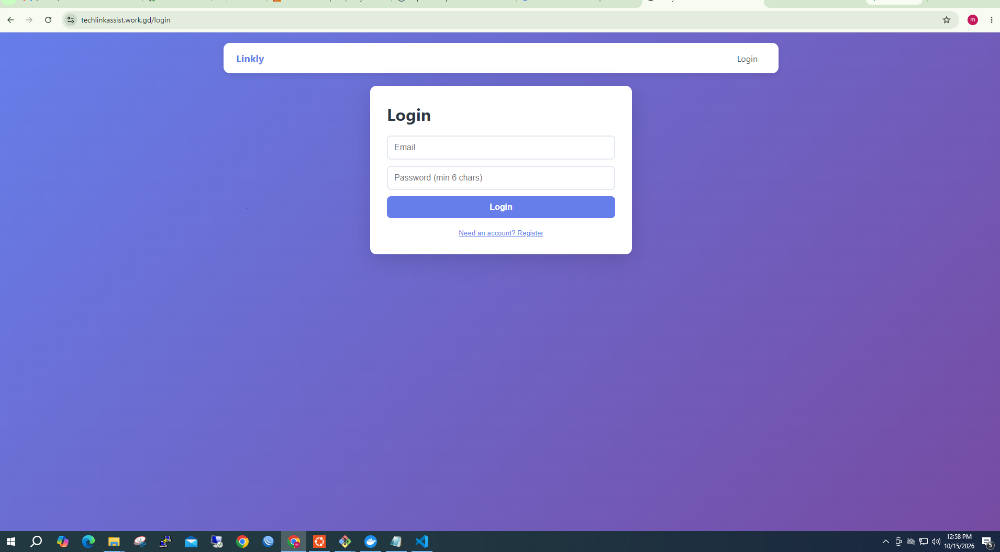
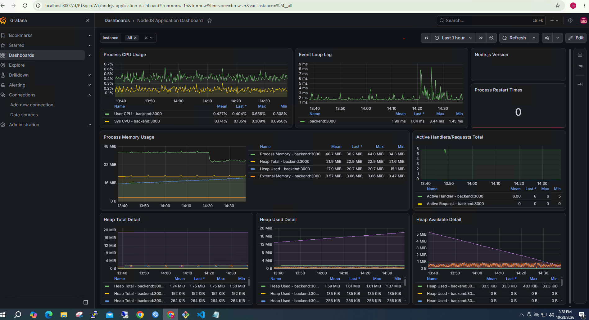

# 🔗 Linkly — Production-Grade URL Shortener SaaS


A production-ready application deployed on AWS with full CI/CD automation, SSL, and 24/7 monitoring.

> **Live Demo:** _Offline (AWS cost optimization). Full setup documented in `docs/`._



---

## 🛠️ Tech Stack

| Layer | Technology |
|-------|-----------|
| **Backend & Frontend** | Node.js + React (Containerized) |
| **Database & Cache** | PostgreSQL 16 + Redis 7 |
| **Containers** | Docker + Docker Compose |
| **Proxy** | Nginx + Let's Encrypt |
| **Cloud** | AWS EC2 (Ubuntu) |
| **CI/CD** | GitHub Actions |
| **Monitoring** | Prometheus + Grafana + Uptime Kuma |

---

## ✨ Infrastructure & DevOps Highlights

- 🐳 **Multi-stage Docker builds** to minimize image size and attack surface.
- 🔒 **VPS Hardening:** SSH Key authentication, UFW Firewall, non-root containers.
- 🌐 **Nginx Reverse Proxy:** Handles API routing, IP-blocking, and SSL termination.
- 🔐 **Zero-Downtime Deployments:** Automated rollback script if health checks fail.
- 💾 **Automated Backups:** Daily database dumps via Cronjob with retention policy.
- 📈 **Observability:** Prometheus metrics scraped from the backend and visualized in Grafana.
- ⏱️ **Uptime & Alerts:** Uptime Kuma monitors endpoints and SSL expiry 24/7.

---

## 🏗️ System Architecture

```text
Users → Nginx (443, SSL) → Backend :3000 → PostgreSQL
                          ↘ Frontend :8080 → Redis
                          
Monitoring: Backend → Prometheus → Grafana (via SSH Tunnel)
CI/CD: git push → GitHub Actions → SSH deploy → Live in ~2 min.

## 🚀 Quick Start

```bash
git clone git@github.com:mazid-dev/linkly.git
cd linkly
cp backend/.env.example backend/.env
cp frontend/.env.example frontend/.env
docker compose up --build -d
docker compose exec -T db psql -U linkly -d linkly < backend/migrations/001_init.sql
```

**Access:**
- Frontend: http://localhost:8080
- API: http://localhost:3000
- Health: http://localhost:3000/health

---

## 📸 Screenshots

| Application UI | Monitoring (Grafana) |
|:---:|:---:|
|  |  |

| CI/CD Pipeline | Uptime (Uptime Kuma) |
|:---:|:---:|
|  |  |
---

## 📡 API Overview

| Method | Endpoint | Description |
|--------|----------|-------------|
| `POST` | `/api/auth/register` | Register new user |
| `POST` | `/api/auth/login` | Login & get JWT |
| `POST` | `/api/shorten` | Create short URL (auth) |
| `GET` | `/api/urls` | List user URLs (auth) |
| `GET` | `/:code` | Redirect to original |
| `GET` | `/health` | Health check |

📖 **Full API reference:** [docs/API.md](./docs/API.md)


---


## 👨‍💻 Author

**Md Mazid Hossain** — DevOps Engineer

[](https://github.com/mazid-dev)
[](https://www.linkedin.com/in/md-mazid-hossain-293561227/)

---

## 📄 License

MIT — see [LICENSE](./LICENSE)
